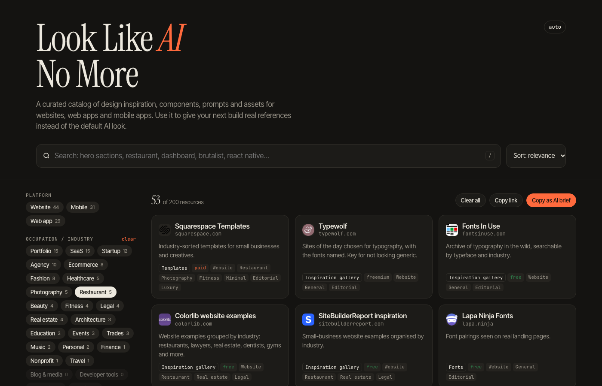

# Look Like AI No More

A curated, tagged catalog of **200 design resources** for building websites, web apps and mobile
apps that don't look AI-generated: inspiration galleries, MotionSites-style prompt libraries, AI
builders, animated component libraries, templates, design systems, UX pattern libraries, fonts,
colour tools, icons, illustrations, backgrounds and mockups.

Every entry is tagged by **platform**, **occupation / industry**, **style**, **resource type**,
**price** and **tech**. All links were checked on 2026-11-27.

**Browse it online: https://thisguyneedsasite.com/LookLikeAiNoMore/**



## Use it

- **Browse:** visit the link above, or open `index.html` locally (or run `python3 -m http.server` here and visit
  http://localhost:8000). Search, filter by any tag, share a filtered view with **Copy link**, or
  hand the current results to an AI with **Copy as AI brief**.
- **From Claude Code:** the `look-like-ai-no-more` skill (`skill/look-like-ai-no-more/`) searches
  the catalog and turns the results into a design brief before any UI gets built.
  ```bash
  python3 skill/look-like-ai-no-more/search.py --platform website --occupation restaurant --style editorial
  ```

## Layout

| Path | What it is |
|---|---|
| `data/sites.json` | Source of truth: every entry and its tags |
| `index.html` | Searchable catalog page (data embedded by the build) |
| `scripts/build.py` | Validates the data, embeds it in `index.html`, copies it into the skill |
| `skill/look-like-ai-no-more/` | The Claude Code skill: `SKILL.md`, `search.py`, `sites.json`, `catalog.html` |

## Adding a site

Add an object to `data/sites.json` with `id`, `name`, `url`, `type`, `platforms`, `occupations`
(`all` = general), `styles` (`mixed` = varied), `pricing`, `tech` and `description`, then run:

```bash
python3 scripts/build.py
```

## Install the skill

```bash
git clone https://github.com/adfleshner/LookLikeAiNoMore.git
```

```bash
ln -s "$PWD/LookLikeAiNoMore/skill/look-like-ai-no-more" ~/.claude/skills/look-like-ai-no-more
```

As a symlink the skill picks up catalog changes right away.

Not affiliated with MotionSites or any listed site; names belong to their owners.
