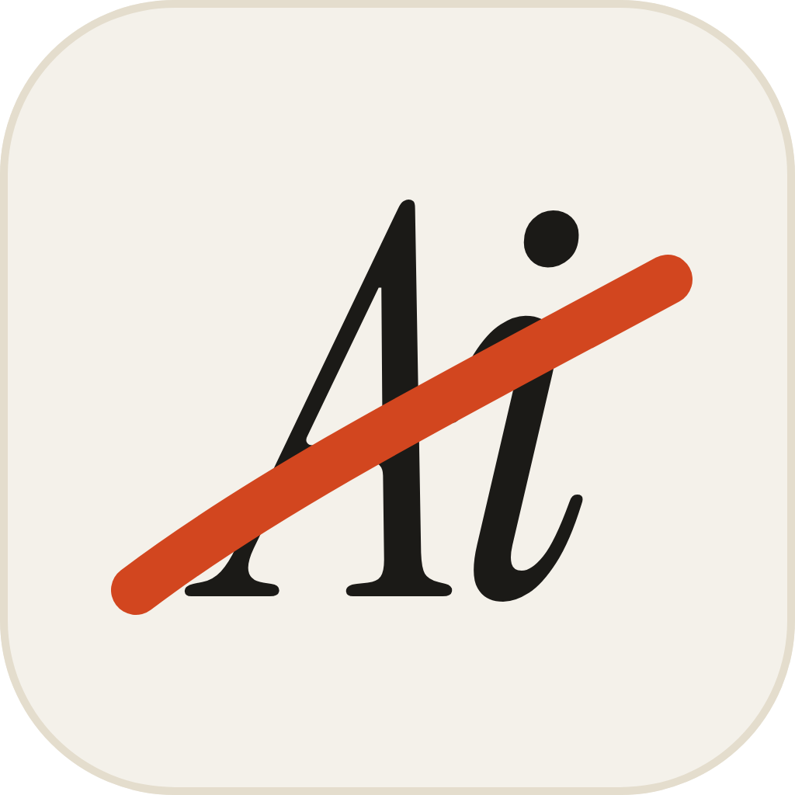
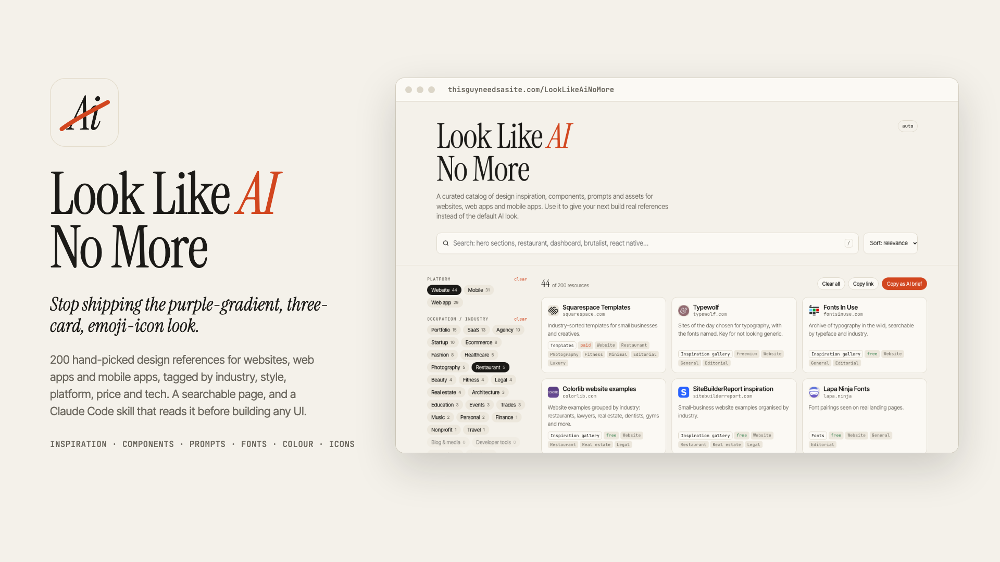
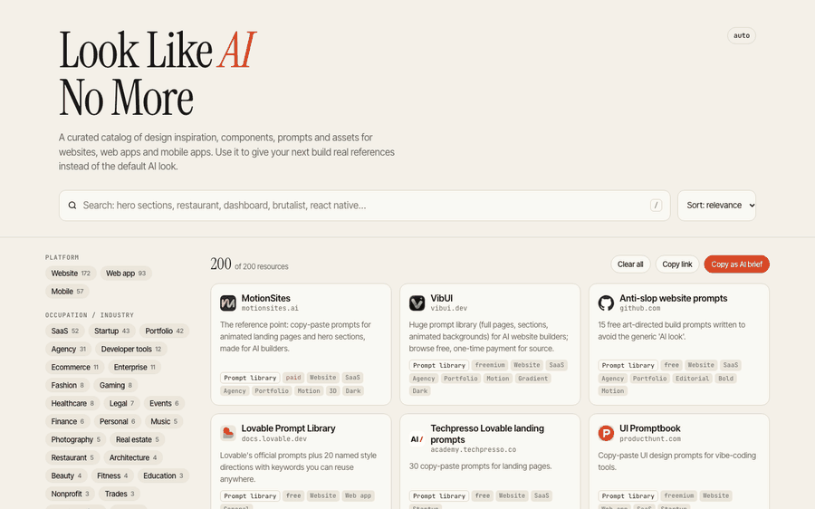
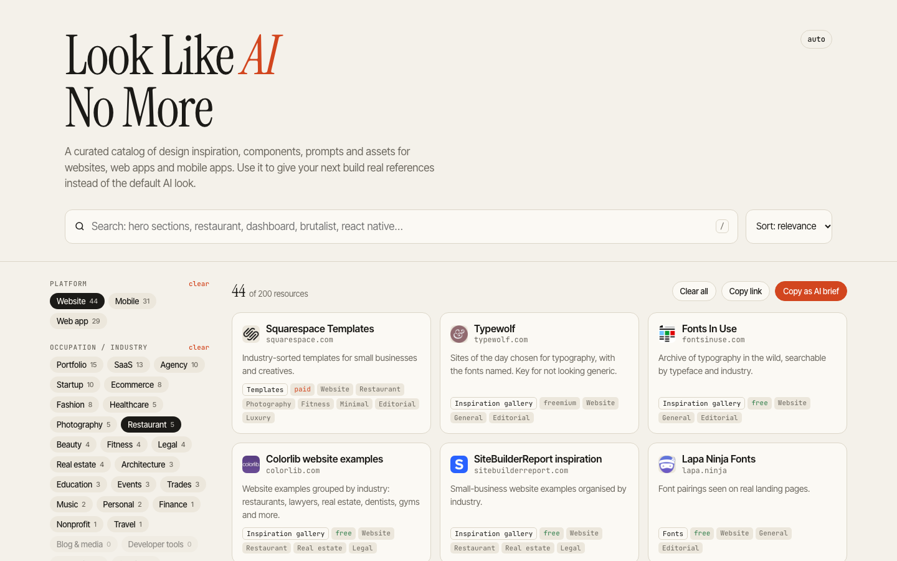
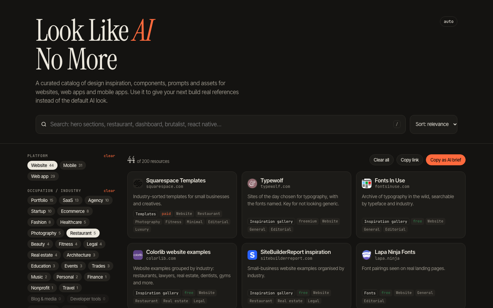

<p align="center">
  
</p>

<h1 align="center">Look Like AI No More</h1>

<p align="center">
  <b>Stop shipping the purple-gradient, three-card, emoji-icon look.</b><br>
  200 hand-picked design references for websites, web apps and mobile apps, tagged by industry, style, platform,
  price and tech, as a searchable page and a Claude Code skill.
</p>

<p align="center">
  
</p>

## TL;DR

**Does everything your AI assistant builds look the same?** Centred hero, purple-to-blue gradient, Inter, three
identical cards with emoji icons. That's what a model falls back on when nobody gives it real references. This
catalog is those references: inspiration galleries, prompt libraries, component libraries, templates, fonts and
colour tools, each tagged so you can pull the right ten for "a restaurant website, editorial style" in seconds.

**Use it in a minute:**

1. **Browse:** open **[the catalog online](https://thisguyneedsasite.com/LookLikeAiNoMore/)**, pick filters, then
   **Copy link** to share the view or **Copy as AI brief** to paste the results into any AI tool.
2. **Or give it to Claude Code:** `git clone https://github.com/adfleshner/LookLikeAiNoMore.git`, then
   `ln -s "$PWD/LookLikeAiNoMore/skill/look-like-ai-no-more" ~/.claude/skills/look-like-ai-no-more`.
   Claude then checks the catalog and writes a design brief before building any UI.

Uninstall the skill: `rm ~/.claude/skills/look-like-ai-no-more`. Build from source:
`python3 scripts/build.py` after editing `data/sites.json`.

No account, no tracking, no build step to browse: it's one HTML file with the data inside.

<p align="center">
  
</p>

| Light | Dark |
|---|---|
|  |  |

## The problem it fixes

Ask an AI tool for a landing page and you can usually tell, at a glance, that it wrote it:

- **Purple, indigo or blue gradients** and glowing blobs with no reason to be there.
- **Everything centred**, every section the same width, **three or four identical cards** with an icon and two lines.
- **Inter or the system font everywhere**, one weight, no contrast.
- **Emoji or generic line icons** as the main visuals; glass cards on a dark mesh background.
- **Copy like "Unlock the power of…"**.
- Asking it to "make it look less generic" just produces a different generic.

## Why it happens

1. A model with no references reaches for the most common patterns in what it has seen, and for UI those are the
   same few startup templates.
2. "Make it look good" gives it nothing concrete to aim for: no type pairing, no layout rhythm, no industry
   conventions.
3. Good references exist, but they're spread over hundreds of galleries and libraries with no common tagging, so
   nobody (person or model) checks them before building.

The skill's workflow and its list of AI tells are in
[skill/look-like-ai-no-more/SKILL.md](skill/look-like-ai-no-more/SKILL.md); the catalog's format and build are in
[docs/how-it-works.md](docs/how-it-works.md).

## Why it was created

Interfaces built with AI help kept coming out with the same look, and fixing it afterwards meant hunting for
examples one gallery at a time. Collecting those galleries, component libraries and prompt libraries in one place,
tagged the same way, made the right references a search away, for people and for Claude. Every link was checked
on 2026-11-27.

## Features

- **200 resources** across 16 types: inspiration galleries, MotionSites-style **prompt libraries**, AI builders,
  animated **component libraries**, templates, design systems, UX flows, UI kits, fonts, colour, icons,
  illustrations, photos, backgrounds, animation and mockups.
- **Tagged six ways**: platform (website, web app, mobile), **occupation / industry** (restaurant, SaaS, legal,
  portfolio, real estate…), **style** (editorial, brutalist, minimal, motion, 3D…), type, price (free, freemium,
  paid) and tech (React, Tailwind, shadcn, React Native, Flutter, SwiftUI, Framer, Webflow…).
- **A searchable page** with live counts on every filter, free-text search, three sort orders, and light and dark
  themes.
- **Shareable views**: the filters live in the URL, so **Copy link** shares exactly what you see.
- **Copy as AI brief** turns the current results into a prompt you can paste into any AI tool.
- **A Claude Code skill** that searches the catalog (`search.py`), studies the best matches, writes a design brief
  before any code, and checks the result against a list of **AI tells**.
- **MCP servers, in their own view**: 15 entries have an MCP server Claude can use (shadcn/ui, Untitled UI,
  HeroUI, 21st.dev, Mobbin, Refero, MotionSites, Figma, Framer, Webflow and more). The **MCP servers you can add to
  Claude** button shows just those, free ones first, each with a copyable install command.
- **General resources stay visible**: entries tagged for every industry or mixed styles still match a filter, ranked
  below specific ones (turn that off with `--specific-only` in `search.py`).

## Install

### Browse it (recommended)

Open **https://thisguyneedsasite.com/LookLikeAiNoMore/**. To use it offline, open `index.html` from a clone, or run
`python3 -m http.server` in the folder and visit http://localhost:8000.

### Add the skill to Claude Code

```bash
git clone https://github.com/adfleshner/LookLikeAiNoMore.git
```

```bash
ln -s "$PWD/LookLikeAiNoMore/skill/look-like-ai-no-more" ~/.claude/skills/look-like-ai-no-more
```

As a symlink, the skill picks up catalog changes after a `git pull`. Search it yourself with:

```bash
python3 skill/look-like-ai-no-more/search.py --platform website --occupation restaurant --style editorial
```

`--facets` lists every valid tag; `--json` prints machine-readable results.

### Add the free MCP servers

These three need no account. Magic UI and React Bits work through the shadcn one.

```bash
claude mcp add shadcn -- npx shadcn@latest mcp
```

```bash
claude mcp add --transport http untitledui https://www.untitledui.com/react/api/mcp
```

```bash
claude mcp add heroui-react -- npx -y @heroui/react-mcp@latest
```

The rest are listed with `search.py --mcp` and on the site.

### Uninstall

```bash
rm ~/.claude/skills/look-like-ai-no-more
```

### Add a site

Add an object to `data/sites.json` with `id`, `name`, `url`, `type`, `platforms`, `occupations` (`all` =
general), `styles` (`mixed` = varied), `pricing`, `tech` and `description`, then run:

```bash
python3 scripts/build.py
```

It validates the data and refreshes both `index.html` and the skill's copy.

### Regenerating the README images

`scripts/render-assets.sh` screenshots the real page in headless Chrome, using its shareable URLs for each filter,
builds the GIF, and renders the icon and hero from `scripts/art/`.

## How the filters combine

| Situation | Rule |
|---|---|
| Several values in one group (e.g. two styles) | Any of them matches (OR) |
| Values in different groups | All groups must match (AND) |
| Entry tagged occupation `all` or style `mixed` | Still matches an occupation or style filter, ranked lower |
| Free-text search | Every word must appear in the name, description, URL or tags |

## Limitations

- **Hand-curated, so it's a snapshot.** Links were checked on 2026-11-27; sites move, change prices or close.
- **Tags are judgement calls**, especially style. Treat them as a starting point.
- **It points to references; it doesn't host them.** The quality of the result still depends on studying them.
- **The skill is for Claude Code.** Other tools can use the page's **Copy as AI brief** instead.

## FAQ

**Is it only for AI-built sites?**
No. It's a design reference catalog; the skill is one way to use it.

**Are these affiliate links?**
No. Every link goes straight to the resource, with no tracking.

**Does the skill copy designs from these sites?**
Its instructions say to study 3–5 real sites for concrete moves (grid, type pairing, colour ratio) and never copy
one wholesale.

**Can I suggest a site?**
Yes: open an issue or a pull request that adds it to `data/sites.json`.

---

MIT licensed. Not affiliated with MotionSites or any listed site; names and trademarks belong to their owners.
